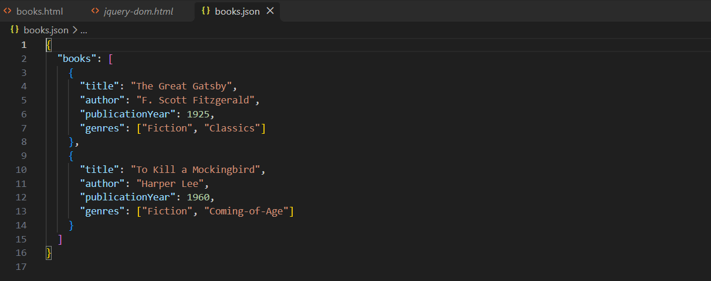
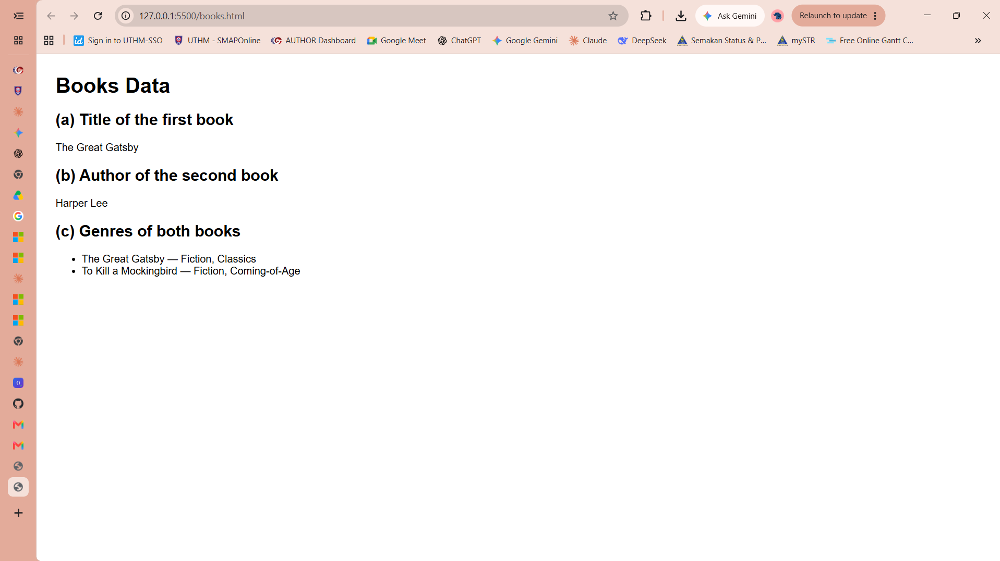
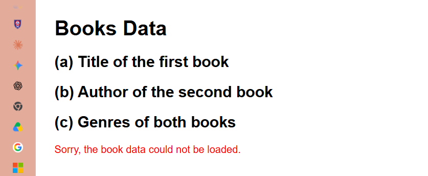
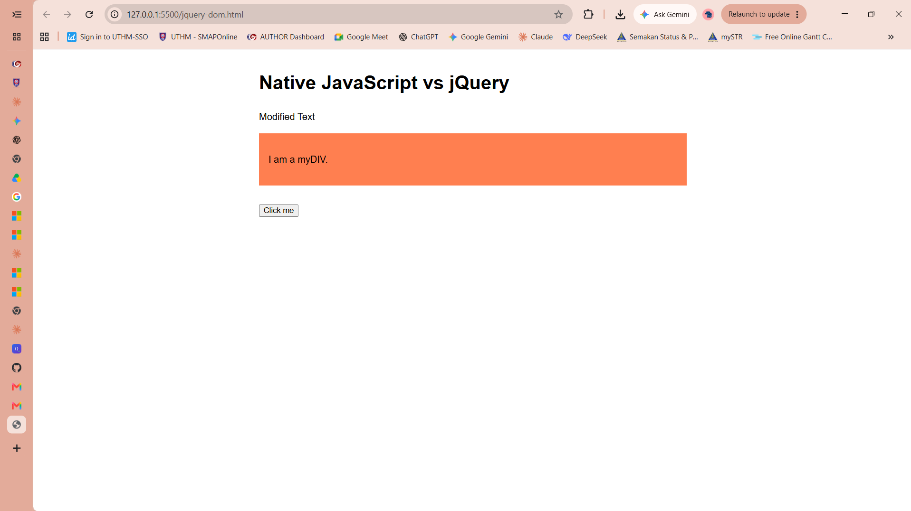

# BIC21203 Lab 4B - Client-Side Scripting (JSON and jQuery)

## Student details
- **Name:** PIRRAVIIN A/L MANIMARAN
- **Student ID:** CI240058
- **Course:** BIC21203

- **GitHub repository:** https://github.com/pirraviinuthm/bic21203-lab4b

## Files

| File | Purpose |
| --- | --- |
| `books.json` | Q1 - JSON dataset with a top-level `"books"` array (two books) |
| `books.html` | Q2 - loads `books.json` with `fetch()` and displays the results on the page |
| `jquery-dom.html` | Q3 - jQuery 4.0.0 (full build, CDN) equivalents of three native DOM operations |

## Setup

1. Install [Visual Studio Code](https://code.visualstudio.com/) and the **Live Server** extension.
2. Clone or download this repository and open the folder in VS Code.
3. Right-click `books.html` and choose **Open with Live Server** (do **not** open it with `file://`, because `fetch()` cannot read local files that way).
4. Open `jquery-dom.html` the same way (needs an internet connection to load jQuery from `https://code.jquery.com/jquery-4.0.0.min.js`).

Alternative without VS Code (Python 3):

```bash
python3 -m http.server 8000
# then open http://localhost:8000/books.html and http://localhost:8000/jquery-dom.html
```

## Expected results

- **books.html:** `The Great Gatsby`, `Harper Lee`, `The Great Gatsby — Fiction, Classics`, `To Kill a Mockingbird — Fiction, Coming-of-Age`. If `books.json` is missing or invalid, a short error message is shown instead.
- **jquery-dom.html:** `#myElement` shows "Modified Text", `#myDIV` gets a coral background (`myStyle`), and clicking the button shows an alert "Button clicked!".

## Screenshots





